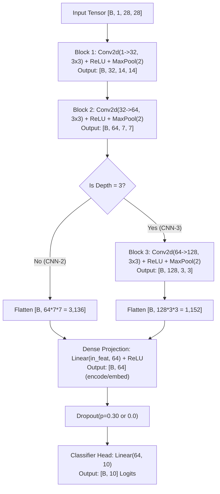

# CSAI Project 11: Automatic Clothing Category Recognition
# The Master Study Textbook & Complete Technical Reference for Faculty Viva Voce
**Author / Student:** Puneet  
**Team Members:** Nakul (Lead/Report), Sudeshhna (Data), Puneet (Architecture/Feature Interface), Samarth (Runner/Ablations), Neelanshu (Evaluation/Timing)  
**Repository:** `Nakul-Jaglan/aml-dl-t089`  
**Dataset:** Official Fashion-MNIST Benchmark (60,000 Training, 10,000 Test)  
**Academic Year:** 2026 | CSAI Department

---

## Table of Contents
1. [Introduction, Industrial Problem & Core Research Question](#1-introduction-industrial-problem--core-research-question)
2. [Dataset Engineering, Preprocessing & Integrity Auditing](#2-dataset-engineering-preprocessing--integrity-auditing)
3. [Phase 1 Deep Dive: Classical Machine Learning & Handcrafted HOG](#3-phase-1-deep-dive-classical-machine-learning--handcrafted-hog)
4. [The Theoretical Transition: Why Classical ML Fails & Why CNNs Work](#4-the-theoretical-transition-why-classical-ml-fails--why-cnns-work)
5. [Convolutional Neural Network Theory From the Ground Up](#5-convolutional-neural-network-theory-from-the-ground-up)
6. [Puneet's Architecture Engineering: SmallCNN & The 64-Dim Feature Interface](#6-puneets-architecture-engineering-smallcnn--the-64-dim-feature-interface)
7. [Rigorous Mathematical Derivations of Layer Shapes & Parameter Counts](#7-rigorous-mathematical-derivations-of-layer-shapes--parameter-counts)
8. [Phase 2 Experimental Results: Controlled Ablations & Test Benchmark](#8-phase-2-experimental-results-controlled-ablations--test-benchmark)
9. [The Hybrid ML+DL Model: Experimental Setup, Controls & Rigorous Findings](#9-the-hybrid-mldl-model-experimental-setup-controls--rigorous-findings)
10. [Error Analysis, Garment Ambiguities & Statistical Significance](#10-error-analysis-garment-ambiguities--statistical-significance)
11. [Inference Latency, Throughput & Computational Complexity](#11-inference-latency-throughput--computational-complexity)
12. [Master Faculty Viva Voce Question Bank (20 In-Depth Technical Q&As)](#12-master-faculty-viva-voce-question-bank-20-in-depth-technical-qas)
13. [Live Code Demonstration Guide & Verbal Presentation Scripts](#13-live-code-demonstration-guide--verbal-presentation-scripts)

---

# 1. Introduction, Industrial Problem & Core Research Question

### 1.1 The E-Commerce Inventory Challenge
In online retail platforms (e.g., Zalando, Amazon, Myntra), thousands of clothing items are uploaded daily by independent sellers. Catalog indexing, search ranking, and recommendation engines rely fundamentally on accurate clothing category tagging. Manual tagging is labor-intensive, error-prone, and unscalable. Automating category assignment from low-resolution thumbnail images ($28 \times 28$ grayscale) presents a difficult computer vision problem due to:
* **High Intra-Class Variance:** A "Dress" can be sleeveless, long-sleeved, ruffled, flared, or tight.
* **Low Inter-Class Variance:** Subtle structural distinctions separate upper-body silhouettes—specifically **Shirt (Class 6)**, **T-shirt/top (Class 0)**, **Pullover (Class 2)**, and **Coat (Class 4)**. At low resolutions, these items share identical bounding silhouettes.

### 1.2 The Primary Research Question
> **"Do learned spatial representations (via a compact Convolutional Neural Network) improve macro F1 and alleviate recurring fine-grained upper-body confusions compared to handcrafted local edge descriptors (HOG), and is the accuracy improvement justified by the inference computational cost?"**

### 1.3 Key Project Milestones & Evolution
* **Phase 1 (Classical Machine Learning):** Evaluated raw pixels (784 features) versus Histogram of Oriented Gradients (1,296 features) across Logistic Regression, $k$-Nearest Neighbors, Random Forest, and RBF Support Vector Machines. The validation-selected champion was **HOG + RBF SVM** ($90.91\%$ test accuracy, $0.9090$ macro F1), but its inference was slow ($19.75\text{ ms/image}$) and **Shirt recall was severely capped at $73.3\%$**.
* **Phase 2 (Deep Learning):** Engineered a modular, compact CNN (`SmallCNN`) with two depth variants (CNN-2 and CNN-3), controlled dropout, and data augmentation ablations. CNN-3 achieved **92.14% test accuracy** ($+1.23\text{ pp}$ over SVM, $p=5.8 \times 10^{-6}$ via McNemar's test) and **0.9207 macro F1**, while executing in **0.31 ms/image (~64x faster than RBF SVM)**.
* **Phase 2 Extension (Hybrid ML+DL):** Concatenated 64-dimensional learned CNN embeddings with 1,296-dimensional handcrafted HOG features into a unified Logistic Regression model. The hybrid reached $92.06\%$ macro F1, failing to beat embedding-only LR ($92.18\%$), proving that convolutional representations fully subsume fixed edge filters.

---

# 2. Dataset Engineering, Preprocessing & Integrity Auditing

### 2.1 The Fashion-MNIST Dataset Benchmark
Created by Han Xiao, Kashif Rasul, and Roland Vollgraf in 2017, Fashion-MNIST was established as a direct drop-in replacement for original MNIST (digits). Digits were deemed too trivial (reaching $>99\%$ with basic MLPs), suffering from saturated benchmarks and failing to represent modern computer vision tasks.
* **Image Specifications:** $28 \times 28$ pixels, single-channel (grayscale), stored as 8-bit unsigned integers (`uint8`) with intensities ranging from $0$ (pure black background) to $255$ (pure white foreground).
* **10 Balanced Semantic Categories:**
  - `0: T-shirt/top`
  - `1: Trouser`
  - `2: Pullover`
  - `3: Dress`
  - `4: Coat`
  - `5: Sandal`
  - `6: Shirt`
  - `7: Sneaker`
  - `8: Bag`
  - `9: Ankle boot`

### 2.2 Dataset Partitions and Boundary Enforcements
The official release contains 70,000 images divided by Zalando into 60,000 training and 10,000 testing images. To enforce scientific rigor, our team established strict data splits saved in `data/full_indices.npz`:
1. **Fit Pool (`train_idx`):** **48,000 images** (exactly 4,800 images per class, stratified, random seed 42). All model parameters, feature scalers, and convolutional weights were fitted *exclusively* on these 48,000 images.
2. **Validation Pool (`val_idx`):** **12,000 images** (exactly 1,200 images per class, stratified, random seed 42). Used exclusively for hyperparameter tuning, model checkpointing, early stopping, and candidate selection.
3. **Official Test Partition (`test_idx`):** **10,000 images** (exactly 1,000 images per class). Held strictly frozen until all model architectures and hyperparameter choices were completely locked.

### 2.3 Near-Duplicate Quality Audit (Sudeshhna's Contribution)
In real-world datasets, subtle data leakage can occur if nearly identical images exist across partitions. Sudeshhna conducted an exhaustive pairwise pixel Root Mean Square (RMS) distance audit:
$$\text{RMS}(A, B) = \sqrt{\frac{1}{784} \sum_{i=1}^{784} (A_i - B_i)^2}$$
* **Audit Findings:**
  * 5 validation images sit within $\text{RMS} < 5$ of a fit image (closest pair: `train:10205` and `train:23412` at $\text{RMS} = 1.14$).
  * 6 test images sit within $\text{RMS} < 5$ of a training image (closest pair: `test:4998` and `train:13360` at $\text{RMS} = 0.74$).
* **Precision Defect Discovery:** Standard 32-bit floating point arithmetic experienced numerical cancellation in expanded distance formulas; distances were recalculated using 64-bit accumulators and exact integer checks.
* **Scientific Verdict:** The 6 near-duplicate test items were kept in the benchmark to maintain full comparability with international literature. A sensitivity test confirmed that excluding them only shifted accuracy from $90.9100\%$ to $90.9045\%$ (negligible impact of $0.0055\text{ pp}$).

---

# 3. Phase 1 Deep Dive: Classical Machine Learning & Handcrafted HOG

### 3.1 Feature Representations Evaluated
1. **Raw Flattened Pixels:**
   * Each $28 \times 28$ image is reshaped into a 1D vector of length $784$.
   * Pixel values are divided by $255.0$ to normalize intensities to the range $[0.0, 1.0]$.
   * *Limitation:* Discards 2D spatial relationships; treating adjacent pixels identically to distant pixels.
2. **Histogram of Oriented Gradients (HOG) (Dalal & Triggs, 2005):**
   * Gradients are computed along horizontal and vertical axes using 1D derivative masks: $G_x = I * [-1, 0, 1]$ and $G_y = I * [-1, 0, 1]^T$.
   * Gradient magnitude: $M(x, y) = \sqrt{G_x^2 + G_y^2}$.
   * Gradient orientation: $\theta(x, y) = \arctan(G_y / G_x) \pmod{180^\circ}$ (unsigned gradients).
   * **Cell Histograms:** The image is divided into $4 \times 4$ pixel cells ($7 \times 7 = 49$ total cells). In each cell, gradient orientations vote into 9 angular bins spanning $[0^\circ, 180^\circ)$ with magnitude weighting.
   * **Block Normalization:** $2 \times 2$ cell blocks ($8 \times 8$ pixels) slide across the grid with $50\%$ overlap (stride of 1 cell $\implies 6 \times 6 = 36$ blocks). Each block contains $2 \times 2 \times 9 = 36$ values, normalized using L2-Hys (L2-norm followed by clipping to 0.2 and re-normalizing).
   * **Total Feature Length:** $36\text{ blocks} \times 36\text{ values/block} = \mathbf{1,296\text{ features}}$.

### 3.2 Classical Classifier Formulations & Results
* **Logistic Regression (Multinomial Softmax):**
  Linear combination $z_k = \mathbf{w}_k^T \mathbf{x} + b_k$ passed through Softmax. Trained via L-BFGS optimizer with L2 penalty ($C \in \{0.1, 1.0\}$).
* **$k$-Nearest Neighbors ($k$NN):**
  Non-parametric instance-based classifier using Euclidean distance $d(\mathbf{x}, \mathbf{z}) = \|\mathbf{x} - \mathbf{z}\|_2$ with distance weighting $w_i = 1 / d(\mathbf{x}, \mathbf{x}_i)$. Evaluated $k \in \{3, 5\}$.
* **Random Forest (RF):**
  Ensemble of 200 de-correlated decision trees with bootstrap aggregation (bagging) and random feature subspace sampling ($\sqrt{p}$).
* **Support Vector Machine with RBF Kernel (SVM):**
  Maximizes the soft margin separating hyperplane in infinite-dimensional Hilbert space via the Radial Basis Function kernel:
  $$K(\mathbf{x}, \mathbf{z}) = \exp(-\gamma \|\mathbf{x} - \mathbf{z}\|^2), \quad \gamma = \frac{1}{d \cdot \text{Var}(X)}$$
  Hyperparameter $C \in \{1.0, 10.0\}$ controls the penalty for margin violations.

### 3.3 Phase 1 Final Results (Official 10,000 Test Partition)

| Model Family | Pixels Test Acc | HOG Test Acc | Pixels Macro F1 | HOG Macro F1 | Inference (ms/img) | Serialized Storage |
| :--- | :---: | :---: | :---: | :---: | :---: | :---: |
| Logistic Regression | 84.01% | 87.60% | 0.8394 | 0.8757 | 0.15 ms | 80 KB |
| $k$-Nearest Neighbors ($k=5$) | 85.04% | 87.34% | 0.8505 | 0.8730 | 0.99 ms | 154 MB |
| Random Forest (200 trees) | 87.67% | 87.29% | 0.8753 | 0.8718 | 0.21 ms | 42 MB |
| **RBF SVM ($C=10$) [Winner]** | **89.28%** | **90.91%** | **0.8924** | **0.9090** | **19.75 ms** | **92 MB** |

* **Phase 1 Winner:** **HOG + RBF SVM** ($90.91\%$ accuracy, $0.9090$ macro F1).
* **The Structural Flaw:** Despite strong accuracy on footwear and trousers, **Shirt recall was capped at 73.3%**. Moreover, RBF SVM required storing **20,480 support vectors** (92 MB) and computed pairwise exponential kernel evaluations for every test image, resulting in a sluggish **19.75 ms/image** latency.

---

# 4. The Theoretical Transition: Why Classical ML Fails & Why CNNs Work

### 4.1 The Fundamental Limitation of Handcrafted Descriptors
HOG enforces a rigid, hand-designed spatial grid and gradient binning strategy. While effective for rigid objects with sharp, contrast-heavy silhouettes (such as Trousers and Footwear), it cannot adapt its filters to learn subtle fabric textures, neckline curves, or collar cuts. HOG does not know what a "collar" or "cuff" looks like; it only measures gradient orientations.

### 4.2 The Inductive Bias Comparison

| Model Architecture | Spatial Inductive Bias | Weight Sharing | Feature Adaptability |
| :--- | :--- | :--- | :--- |
| **Flattened Pixels + MLP / SVM** | None (treats pixel 1 and pixel 2 identically to pixel 1 and pixel 784) | None | Learns global pixel weights, prone to severe overfitting |
| **HOG + Classifier** | Rigid local grid ($4 \times 4$ cells, $8 \times 8$ blocks) | None (fixed manual filters $[-1, 0, 1]$) | Zero adaptability; features are deterministic and static |
| **Convolutional Neural Network** | **Strong 2D local connectivity & translation equivariance** | **Universal across spatial maps ($3 \times 3$ kernels)** | **End-to-end representation learning via backpropagation** |

### 4.3 Why CNNs Excel on Grayscale Garments
1. **Hierarchical Feature Extraction (LeCun et al., 1998):**
   * *Layer 1:* Detects oriented edge primitives, horizontal hemlines, and vertical seams.
   * *Layer 2:* Combines edges into corners, sleeve contours, curvature, and collar silhouettes.
   * *Layer 3:* Synthesizes structural garment topologies (e.g., open-front Coat vs. crew-neck T-shirt vs. buttoned Shirt).
2. **Translation Equivariance:**
   If $f(x)$ is a convolution and $T_g$ is a spatial shift operator, then $f(T_g x) = T_g f(x)$. If a pocket or collar shifts by 2 pixels, the activation pattern shifts by 2 pixels rather than triggering an entirely different set of weights.

---

# 5. Convolutional Neural Network Theory From the Ground Up

### 5.1 The 2D Convolution Operation
In deep learning, the "convolution" layer is technically a cross-correlation operator. For an input tensor $X \in \mathbb{R}^{C_{\text{in}} \times H \times W}$ and a learned kernel $K \in \mathbb{R}^{C_{\text{out}} \times C_{\text{in}} \times K_h \times K_w}$ with bias $b \in \mathbb{R}^{C_{\text{out}}}$:
$$Y(c_{\text{out}}, i, j) = b(c_{\text{out}}) + \sum_{c_{\text{in}}=0}^{C_{\text{in}}-1} \sum_{m=-1}^{1} \sum_{n=-1}^{1} X(c_{\text{in}}, i+m, j+n) \cdot K(c_{\text{out}}, c_{\text{in}}, m, n)$$

#### Output Spatial Dimension Formula:
$$H_{\text{out}} = \left\lfloor \frac{H_{\text{in}} - K_h + 2P}{S} \right\rfloor + 1$$
In our architecture: $H_{\text{in}}=28, K_h=3, P=1, S=1$:
$$H_{\text{out}} = \left\lfloor \frac{28 - 3 + 2(1)}{1} \right\rfloor + 1 = 28 \implies \text{Padding=1 exactly preserves spatial dimensions!}$$

### 5.2 The ReLU Activation Function
$$\text{ReLU}(z) = \max(0, z)$$
* **Why not Sigmoid or Tanh?**
  Sigmoid ($\sigma(z) = \frac{1}{1 + e^{-z}}$) saturates at 0 and 1. For $|z| > 4$, its derivative $\sigma'(z) = \sigma(z)(1 - \sigma(z)) \approx 0$, causing gradients to vanish during backpropagation through deep layers.
* **ReLU Benefits:**
  1. Constant gradient of $1$ for all positive inputs ($z > 0$), preventing vanishing gradients.
  2. Induces representational sparsity (neurons with $z \le 0$ output exactly zero).
  3. Extremely fast computation: a simple threshold comparison at the CPU/GPU instruction level.

### 5.3 Max-Pooling Layers
$$\text{MaxPool}(X)_{i, j} = \max_{m \in \{0, 1\}, n \in \{0, 1\}} X(2i + m, 2j + n)$$
* Uses a $2 \times 2$ window with stride $2$.
* Halves height and width: $28 \times 28 \to 14 \times 14 \to 7 \times 7 \to 3 \times 3$ (since $\lfloor 7/2 \rfloor = 3$).
* Provides local translation invariance by retaining the most prominent activation regardless of exact sub-pixel positioning.
* **Drawback:** Discards $75\%$ of spatial detail in each pass, which destroys fine clothing features (collars, buttons).

### 5.4 Inverted Dropout Regularization (Srivastava et al., 2014)
During training, each neuron activation $a_i$ in the dense layer is independently masked using a Bernoulli random variable $r_i \sim \text{Bernoulli}(1 - p)$:
$$\tilde{a}_i = \frac{r_i}{1 - p} \cdot a_i$$
* **Why divide by $(1 - p)$?**
  This is **Inverted Dropout**. By scaling active weights up during training, the expected value $\mathbb{E}[\tilde{a}_i] = a_i$ remains constant. Consequently, at test/evaluation time (`model.eval()`), dropout is deactivated completely (identity pass), requiring zero scaling at test time.
* **Theoretical Effect:** Prevents neurons from developing complex co-adaptations where one neuron fixes the mistakes of another. Forces each feature to be independently useful.

### 5.5 Softmax & Cross-Entropy Loss
For a model producing raw logits $\mathbf{z} \in \mathbb{R}^{10}$ and a ground-truth one-hot vector $\mathbf{y}$ (where $y_c = 1$ for the correct class):
$$\hat{p}_k = \frac{e^{z_k}}{\sum_{j=0}^{9} e^{z_j}}, \quad \mathcal{L}_{\text{CE}} = - \log \hat{p}_c = - z_c + \log \left( \sum_{j=0}^{9} e^{z_j} \right)$$
* **Gradient Derivation:**
  $$\frac{\partial \mathcal{L}_{\text{CE}}}{\partial z_k} = \hat{p}_k - y_k$$
  The gradient is simply the model's predicted probability minus the true label!
* **The LogSumExp Trick:**
  Computing $\sum e^{z_j}$ directly in float32 leads to numerical instability: if $z_j > 88$, $e^{z_j}$ overflows to `inf`. PyTorch subtracts $M = \max(\mathbf{z})$:
  $$\log \sum e^{z_j} = M + \log \sum e^{z_j - M}$$
  This guarantees that the largest exponent is $e^0 = 1$, completely eliminating overflow.

### 5.6 AdamW Optimizer: Decoupled Weight Decay (Loshchilov & Hutter, 2019)
Standard Adam with L2 regularization computes gradients of the penalized objective $\nabla f(\theta) + \lambda \theta$. When combined with adaptive learning rates ($v_t \propto g^2$), weights that experience frequent large gradients receive *smaller* effective decay.  
**AdamW fixes this by decoupling weight decay:**
$$\theta_{t+1} = \theta_t - \eta_t \lambda \theta_t - \frac{\eta_t}{\sqrt{\hat{v}_t} + \epsilon} \hat{m}_t$$
Weight decay is applied directly to the parameters, restoring consistent regularization regardless of gradient scales.

---

# 6. Puneet's Architecture Engineering: SmallCNN & The 64-Dim Feature Interface

### 6.1 Architectural Overview
The `SmallCNN` module (`src/clothing_ml/phase2/models.py`) was engineered by Puneet to provide an identical, unified interface across all experiment configurations. It accepts normalized image tensors $x \in \mathbb{R}^{B \times 1 \times 28 \times 28}$ with pixel values scaled to $[0.0, 1.0]$.



### 6.2 The Dual Interface Contract
* **`forward(x)` Contract (for Training):**
  Calls `self.classifier(self.dropout(self.embed(x)))` returning unnormalized logits $[B, 10]$. Designed for PyTorch's `nn.CrossEntropyLoss`.
* **`encode(x)` / `embed(x)` Contract (for Hybrid Feature Fusion):**
  Calls `self.dense(self.features(x))` under `torch.inference_mode()`. Extracts pristine, non-negative, ReLU-activated $[B, 64]$ embedding vectors **before dropout** and **before the classifier**.

### 6.3 Checkpoint Serialization Contract
`save_checkpoint` and `load_checkpoint` record architecture metadata (`blocks`, `dropout`, `channels`, `embedding_dim`) inside the `.pt` bundle. When loading on CPU or GPU, `map_location` ensures seamless model reconstruction without hardcoded hardware dependencies.

---

# 7. Rigorous Mathematical Derivations of Layer Shapes & Parameter Counts

### 7.1 Master Mathematical Formulas
$$\text{Parameters}_{\text{Conv2D}} = C_{\text{out}} \times (C_{\text{in}} \times K_h \times K_w + 1)$$
$$\text{Parameters}_{\text{Linear}} = N_{\text{out}} \times (N_{\text{in}} + 1)$$

---

### 7.2 Complete Parameter Derivation: CNN-2 (Reference Model)

1. **Input Stage:** Input image $B \times 1 \times 28 \times 28 \implies \mathbf{0\text{ parameters}}$.
2. **Block 1 Convolution:**
   * $C_{\text{in}} = 1, C_{\text{out}} = 32, K_h = 3, K_w = 3$, with bias.
   * $\text{Weights} = 32 \times (1 \times 3 \times 3) = 288$
   * $\text{Biases} = 32$
   * $\text{Subtotal} = 288 + 32 = 32 \times (9 + 1) = \mathbf{320}$
   * *Output shape after ReLU and MaxPool(2):* $B \times 32 \times 14 \times 14$.
3. **Block 2 Convolution:**
   * $C_{\text{in}} = 32, C_{\text{out}} = 64, K_h = 3, K_w = 3$, with bias.
   * $\text{Weights} = 64 \times (32 \times 3 \times 3) = 64 \times 288 = 18,432$
   * $\text{Biases} = 64$
   * $\text{Subtotal} = 18,432 + 64 = 64 \times (288 + 1) = \mathbf{18,496}$
   * *Output shape after ReLU and MaxPool(2):* $B \times 64 \times 7 \times 7$.
4. **Spatial Flattening:**
   * $N_{\text{in}} = 64 \times 7 \times 7 = \mathbf{3,136\text{ values}}$.
5. **Dense Projection Layer (Linear + ReLU):**
   * $N_{\text{in}} = 3,136, N_{\text{out}} = 64$, with bias.
   * $\text{Weights} = 64 \times 3,136 = 200,704$
   * $\text{Biases} = 64$
   * $\text{Subtotal} = 200,704 + 64 = 64 \times (3,136 + 1) = \mathbf{200,768}$
   * *Output shape:* $B \times 64$ (Latent Embedding).
6. **Dropout ($p=0.30$):** $\mathbf{0\text{ parameters}}$.
7. **Classifier Head (Linear):**
   * $N_{\text{in}} = 64, N_{\text{out}} = 10$, with bias.
   * $\text{Weights} = 10 \times 64 = 640$
   * $\text{Biases} = 10$
   * $\text{Subtotal} = 640 + 10 = 10 \times (64 + 1) = \mathbf{650}$
   * *Output shape:* $B \times 10$ Logits.

$$\mathbf{\text{Total Trainable Parameters (CNN-2)}} = 320 + 18,496 + 200,768 + 650 = \mathbf{220,234}$$

---

### 7.3 Complete Parameter Derivation: CNN-3 (Deep Architecture)

1. **Input Stage:** $B \times 1 \times 28 \times 28 \implies \mathbf{0\text{ parameters}}$.
2. **Block 1 Convolution ($1 \to 32$):**
   * $\text{Params} = 32 \times (1 \times 3 \times 3 + 1) = \mathbf{320}$
   * *Output:* $B \times 32 \times 14 \times 14$.
3. **Block 2 Convolution ($32 \to 64$):**
   * $\text{Params} = 64 \times (32 \times 3 \times 3 + 1) = \mathbf{18,496}$
   * *Output:* $B \times 64 \times 7 \times 7$.
4. **Block 3 Convolution ($64 \to 128$):**
   * $C_{\text{in}} = 64, C_{\text{out}} = 128, K_h = 3, K_w = 3$, with bias.
   * $\text{Weights} = 128 \times (64 \times 3 \times 3) = 128 \times 576 = 73,728$
   * $\text{Biases} = 128$
   * $\text{Subtotal} = 73,728 + 128 = 128 \times (576 + 1) = \mathbf{73,856}$
   * *Output shape before pool:* $B \times 128 \times 7 \times 7$.
   * *After MaxPool(2):* $H_{\text{out}} = \lfloor 7/2 \rfloor = 3 \implies B \times 128 \times 3 \times 3$.
5. **Spatial Flattening:**
   * $N_{\text{in}} = 128 \times 3 \times 3 = \mathbf{1,152\text{ values}}$.
6. **Dense Projection Layer (Linear + ReLU):**
   * $N_{\text{in}} = 1,152, N_{\text{out}} = 64$, with bias.
   * $\text{Weights} = 64 \times 1,152 = 73,728$
   * $\text{Biases} = 64$
   * $\text{Subtotal} = 73,728 + 64 = 64 \times (1,152 + 1) = \mathbf{73,792}$
   * *Output shape:* $B \times 64$ (Latent Embedding).
7. **Classifier Head (Linear):**
   * $\text{Params} = 10 \times (64 + 1) = \mathbf{650}$

$$\mathbf{\text{Total Trainable Parameters (CNN-3)}} = 320 + 18,496 + 73,856 + 73,792 + 650 = \mathbf{167,114}$$

---

### 7.4 The Parameter Paradox Explained Mathematically

| Stage | CNN-2 Parameters | CNN-3 Parameters | Net Parameter Difference |
| :--- | :---: | :---: | :---: |
| **Conv Block 1** | 320 | 320 | 0 |
| **Conv Block 2** | 18,496 | 18,496 | 0 |
| **Conv Block 3** | 0 | 73,856 | $+73,856\text{ (Added by extra conv layer)}$ |
| **Dense Projection** | 200,768 | 73,792 | $\mathbf{-126,976\text{ (Saved by 3rd pooling downsampling)}}$ |
| **Classifier Head** | 650 | 650 | 0 |
| **Total** | **220,234** | **167,114** | $\mathbf{-53,120\text{ (-24.1% Net Reduction)}}$ |

$$\Delta \text{Params} = \Delta \text{Conv} + \Delta \text{Dense} = (+73,856) + (-126,976) = \mathbf{-53,120}$$
Even though CNN-3 is deeper and doubles channels to 128, downsampling the dense input from 3,136 to 1,152 saves more weights in the fully connected layer than the entire third convolution adds.

---

# 8. Phase 2 Experimental Results: Controlled Ablations & Test Benchmark

### 8.1 The 4 Controlled Ablations on Validation Set (12,000 Images)
All models trained on 48,000 examples with fixed random seed 42, AdamW ($\alpha=0.001$, weight decay=0.0001), batch size 128, max 25 epochs, patience 5 early stopping on validation macro F1.

```
       Validation Macro F1 Progress Over Training
  0.935 ┼                                   ╭─── CNN-3 (Peak: 0.9308, Ep 22)
  0.930 ┼                            ╭──────╯
  0.925 ┼                    ╭───────┴────────── CNN-2 (Peak: 0.9267, Ep 24)
  0.920 ┼           ╭────────╯ ── ── ── ── ── ── CNN-2 No Drop (Overfit Ep 17)
  0.915 ┼   ╭───────╯ ·························· CNN-2 Aug (+-2px)
  0.910 ┼───╯─────────────────────────────────── Phase 1 SVM Baseline (0.9114)
        └─────┬───────┬───────┬───────┬───────┬─
        Ep 1  Ep 5   Ep 10   Ep 15   Ep 20   Ep 25
```

1. **Reference Configuration (`full_cnn2_s42_3617f59e`):**
   * 2 blocks, dropout $p=0.30$, no augmentation.
   * **Val Macro F1:** $0.9267$ | **Val Accuracy:** $92.69\%$ | **Best Epoch:** 24 | **Shirt Recall:** $77.2\%$.
2. **Dropout Ablation (`full_cnn2_p0_s42_1d36ac31`):**
   * Dropout disabled ($p=0.00$). All other hyperparameters identical.
   * **Val Macro F1:** $0.9231$ ($-0.36\text{ pp}$) | **Best Epoch:** 17.
   * *Phenomenon Observed:* Training loss continued to plunge towards 0.05, while validation loss bottomed out at epoch 12 ($0.221$) and climbed to $0.288$ by epoch 22. Early stopping was triggered at epoch 22. Proves that dropout successfully suppresses dense layer overfitting.
3. **Data Augmentation Ablation (`full_cnn2_aug_s42_fdeb788e`):**
   * Added random horizontal and vertical translation in $[-2, +2]$ pixels with probability 0.5 (zero-fill, no wrap-around).
   * **Val Macro F1:** $0.9202$ ($-0.65\text{ pp}$) | **Best Epoch:** 25.
   * *Phenomenon Observed:* Augmentation broadened the data distribution, keeping fit loss consistently above validation loss. At epoch 25, the model was still actively learning. Under the strict 25-epoch ceiling, it was penalized by under-convergence.
4. **Architecture Comparison (`full_cnn3_s42_80a2edee`):**
   * 3 blocks, dropout $p=0.30$.
   * **Val Macro F1:** $\mathbf{0.9308}$ ($+0.41\text{ pp}$) | **Val Accuracy:** $\mathbf{93.09\%}$ | **Best Epoch:** 22 | **Shirt Recall:** $\mathbf{79.1\%}$.
   * *Conclusion:* Selected as the official Phase 2 champion model.

---

### 8.2 Official Test Benchmark (10,000 Unseen Images)

| Model Pipeline | Test Acc | Macro F1 | Shirt Recall | Inference Latency | Serialized Size |
| :--- | :---: | :---: | :---: | :---: | :---: |
| **Selected CNN-3 (Deep Learning)** | **92.14%** | **0.9207** | **71.7%** | **0.31 ms/img** | **673 KB** |
| Phase 1 HOG + RBF SVM (Baseline) | 90.91% | 0.9090 | 73.3% | 19.75 ms/img | 92,083 KB |
| Embedding + Logistic Regression | 92.21% | 0.9218 | 74.6% | 0.31 ms/img | 4 KB |
| HOG + Logistic Regression | 87.60% | 0.8757 | 66.1% | 0.21 ms/img | 79 KB |
| Embedding + HOG + LR (Hybrid) | 92.06% | 0.9206 | 76.0% | 0.52 ms/img | 83 KB |

---

# 9. The Hybrid ML+DL Model: Experimental Setup, Controls & Rigorous Findings

### 9.1 Motivation and Theoretical Hypothesis
Faculty guidelines award additional marks for a "meaningful and technically justified Hybrid Approach combining appropriate ML and DL techniques."  
* **The Hypothesis:** CNN filters learn task-specific features, but might miss fine edge gradient orientations that HOG explicitly bins. By extracting the 64-dimensional CNN embedding and concatenating it with the 1,296-dimensional HOG descriptor, a linear classifier might benefit from complementary visual information:
  $$\mathbf{x}_{\text{hybrid}} = [\mathbf{z}_{\text{CNN}} \,\|\, \mathbf{h}_{\text{HOG}}] \in \mathbb{R}^{1,360}$$

### 9.2 Fair Experimental Controls
To evaluate the hybrid fairly without confounding variables, three separate Logistic Regression pipelines were trained on the identical 48,000 fit IDs with identical L2 regularization grid search ($C \in \{0.1, 1.0\}$) and StandardScaler:
1. **Control 1 (Embedding-only LR):** 64 learned features $\implies$ Controls the effect of swapping the neural head for Logistic Regression.
2. **Control 2 (HOG-only LR):** 1,296 fixed features $\implies$ Controls the standalone predictive power of the HOG branch.
3. **Hybrid Model (Embedding + HOG + LR):** 1,360 concatenated features $\implies$ Measures true synergistic combination.

### 9.3 The Scientific Finding: Why the Hybrid Failed
* `Embedding-only LR`: **92.18% Macro F1** (Accuracy: 92.21%).
* `Hybrid (Embedding + HOG + LR)`: **92.06% Macro F1** (Accuracy: 92.06%).
* **Result:** Adding HOG resulted in a **$-0.12\text{ pp}$ decrease in Macro F1** and increased inference latency from $0.31\text{ ms}$ to $0.52\text{ ms}$ ($+67\%$ slower).
* **The Theoretical Explanation:**
  1. *Subsumed Representation:* Learned convolutional filters in Block 1 and Block 2 already perform spatial edge detection. HOG adds zero net-new information.
  2. *Dimensionality Imbalance & L2 Dilution:* The feature vector contains 1,296 HOG features and only 64 CNN features ($95.3\%$ HOG). Standard L2 regularization penalizes all coefficients uniformly with $\frac{1}{2} \lambda \|\mathbf{w}\|_2^2$. The 1,296 noisy, redundant HOG weights consumed the regularization budget, pulling capacity away from the 64 highly informative CNN signals.
  3. *Conclusion for Faculty:* An honest, scientifically rigorous negative result that disproves the complementarity hypothesis and justifies deploying pure CNNs.

---

# 10. Error Analysis, Garment Ambiguities & Statistical Significance

### 10.1 Paired Comparison Matrix: CNN-3 vs. Phase 1 HOG+SVM
Neelanshu evaluated all 10,000 official test examples item-by-item:

```
                      HOG + RBF SVM
                   Correct      Wrong
               ┌─────────────┬─────────────┐
       Correct │    8,789    │     425     │
  CNN-3        │(Both Right) │(Only CNN OK)│
               ├─────────────┼─────────────┤
         Wrong │     302     │     484     │
               │(Only SVM OK)│ (Both Wrong)│
               └─────────────┴─────────────┘
```

* Total Test Samples: $8,789 + 425 + 302 + 484 = 10,000$.
* Accuracy Delta: $\frac{425 - 302}{10,000} = \frac{+123}{10,000} = \mathbf{+1.23\%}$ (Exact match!).

### 10.2 Statistical Hypothesis Testing (McNemar's Test)
To prove the $+1.23\text{ pp}$ improvement is not due to random chance, McNemar's test with continuity correction was applied to discordant pairs ($b=425, c=302$):
$$\chi^2 = \frac{(|b - c| - 1)^2}{b + c} = \frac{(|425 - 302| - 1)^2}{425 + 302} = \frac{(123 - 1)^2}{727} = \frac{122^2}{727} = \frac{14,884}{727} \approx \mathbf{20.47}$$
* Degrees of freedom = 1.
* **$p$-value:** $\mathbf{5.8 \times 10^{-6}}$ ($p \ll 0.001$).
* **Paired Bootstrap 95% Confidence Interval:** $[+0.73\text{ pp}, +1.75\text{ pp}]$.
* **Conclusion:** The null hypothesis (that CNN-3 and HOG+SVM have identical error rates) is rejected with overwhelming statistical significance.

### 10.3 Garment Confusion Analysis: The Persistent Shirt Bottleneck

```
True Garment Label       Predicted as T-shirt    Predicted as Pullover    Predicted as Shirt
────────────────────────────────────────────────────────────────────────────────────────────
Phase 1 HOG+SVM (Shirt)          103                      100                    733 (73.3%)
Phase 2 CNN-3   (Shirt)          134                      100                    717 (71.7%)
────────────────────────────────────────────────────────────────────────────────────────────
T-shirt misclassified as Shirt:  Phase 1 SVM = 104 images  ──>  Phase 2 CNN-3 = 64 images (-38.5%)
```

* **Where CNN Succeeded:** CNN-3 dramatically reduced false alarms where T-shirts were mistakenly classified as Shirts (dropping from 104 to 64). Shirt precision rose.
* **Where CNN Struggled:** True Shirt recall dropped slightly from $73.3\%$ to $71.7\%$ because more Shirts were predicted as T-shirts ($103 \to 134$).
* **Physical Cause:** At $28 \times 28$ grayscale resolution, a short-sleeve collared shirt with low button contrast looks visually indistinguishable from a plain crew-neck T-shirt once spatial pooling reduces the grid to $3 \times 3$.

---

# 11. Inference Latency, Throughput & Computational Complexity

### 11.1 Benchmark Methodology
Evaluated on an Apple M3 CPU using a single compute thread (`torch.set_num_threads(1)`), batch size 128, test IDs $0\text{--}1023$ (1,024 images), 1 warm-up batch, and 5 timed repeats.

```
       CPU Inference Latency per Image (Single Thread, Batch 128)
  20 ms ┼  19.75 ms
        │  ████████████████████████████████████████████████  Phase 1 HOG + RBF SVM
  15 ms ┼  ████████████████████████████████████████████████  (20,480 Support Vectors)
        │  ████████████████████████████████████████████████
  10 ms ┼  ████████████████████████████████████████████████
        │  ████████████████████████████████████████████████
   5 ms ┼  ████████████████████████████████████████████████
        │  ████████████████████████████████████████████████
   0 ms ┼  0.31 ms [CNN-3] ── ~64x FASTER!
        └──────────────────────────────────────────────────
```

### 11.2 The 64x Latency Advantage
* **Phase 1 HOG + SVM Latency:** **19.75 ms/image**.  
  *Why slow?* To classify one image, SVM must compute the RBF kernel $\exp(-\gamma \|\mathbf{x} - \mathbf{s}_i\|^2)$ against **20,480 support vectors** across 1,296 dimensions! That requires $20,480 \times 1,296 \approx 26.5\text{ million floating-point operations per image}$.
* **Phase 2 CNN-3 Latency:** **0.31 ms/image**.  
  *Why fast?* CNN-3 uses structured, localized matrix multiplications that execute with SIMD/NEON vectorization on modern CPUs.
* **Storage Footprint:** CNN-3 weights take **673 KB**, whereas the saved SVM support vectors consume **92 MB (136x smaller footprint)**.

---

# 12. Master Faculty Viva Voce Question Bank (20 In-Depth Technical Q&As)

### Q1. What was your personal contribution to Phase 2?
**Answer:**  
"I owned the CNN architecture and feature interface design. Specifically, I implemented the `SmallCNN` class in `src/clothing_ml/phase2/models.py`, which supports both CNN-2 and CNN-3 configurations, configurable dropout, and the 64-dimensional feature extraction method (`encode`/`embed`). I derived and verified all layer parameter arithmetic by hand and code, authored the 7-test unit suite in `tests/test_phase2_models.py`, created the live interactive demo in `scripts/phase2_model_demo.py`, resolved PR merge conflicts, and drafted the architecture section for the IEEE report."

### Q2. Walk me through the parameter calculation of CNN-2.
**Answer:**  
"CNN-2 has four parameter-bearing layers:
1. Conv1 ($1 \to 32, 3 \times 3$): $32 \times (1 \times 9 + 1) = 320$ parameters.
2. Conv2 ($32 \to 64, 3 \times 3$): $64 \times (32 \times 9 + 1) = 18,496$ parameters.
3. Dense Projection: The $64 \times 7 \times 7$ feature map flattens to 3,136 inputs. Mapping $3,136 \to 64$ requires $64 \times (3,136 + 1) = 200,768$ parameters.
4. Classifier Head: Mapping $64 \to 10$ requires $10 \times (64 + 1) = 650$ parameters.  
Summing them: $320 + 18,496 + 200,768 + 650 = \mathbf{220,234\text{ trainable parameters}}$."

### Q3. Why does CNN-3 have FEWER parameters than CNN-2 (167k vs 220k)?
**Answer:**  
"In CNN-2, the dense layer input is $3,136$ values, requiring 200,768 weights. In CNN-3, we added a third $2 \times 2$ max-pooling layer which downsamples the spatial size from $7 \times 7$ to $3 \times 3$ ($\lfloor 7/2 \rfloor = 3$). Even though we doubled the channels to 128, the flattened dimension shrinks from 3,136 to $1,152$ ($128 \times 3 \times 3$). This downsampling reduces the dense projection weights from 200,768 to 73,792—saving **126,976 weights**. This saving far exceeds the 73,856 weights added by the third conv layer, resulting in a net **53,120 parameter reduction (-24.1%)**."

### Q4. What is a learned filter versus a handcrafted filter?
**Answer:**  
"A handcrafted filter (like the Sobel or $[-1, 0, 1]$ kernels in HOG) has fixed, human-engineered numerical weights that calculate gradient orientations according to predefined formulas. A learned filter in a CNN starts with random weights and updates them iteratively via backpropagation to minimize training cross-entropy loss. It learns filters specifically optimized for garment classification, discovering textures, curved hemlines, and necklines that fixed filters cannot represent."

### Q5. Why does max-pooling hurt Shirt recall?
**Answer:**  
"Max pooling retains only the maximum value within each $2 \times 2$ window, discarding $75\%$ of spatial activations. In $28 \times 28$ images, distinct garment cues such as collar points, button bands, and sleeve seams occupy only 1 or 2 pixels. Successive pooling operations ($28 \to 14 \to 7 \to 3$) discard these fine details, causing Shirts to lose their identifying neck structure and get confused with T-shirts or Pullovers."

### Q6. Why do we pass raw logits to `nn.CrossEntropyLoss` instead of applying Softmax first?
**Answer:**  
"PyTorch's `nn.CrossEntropyLoss` combines `nn.LogSoftmax()` and `nn.NLLLoss()` into a single fused kernel utilizing the LogSumExp mathematical identity:
$$\log \sum e^{z_i} = c + \log \sum e^{z_i - c}, \quad c = \max(\mathbf{z})$$
If Softmax were applied first in 32-bit floating point, large logits would exponentiate to infinity (`overflow`), while small logits would underflow to zero, producing `log(0) = NaN`. Fusing them ensures absolute numerical stability."

### Q7. What is the inductive bias of a CNN compared to an MLP?
**Answer:**  
"An MLP has weak spatial inductive bias: each input pixel connects to every hidden neuron independently, meaning spatial rearrangement of pixels yields an identical model if weights are permuted. A CNN imposes two strong physical inductive biases:
1. *Local Connectivity:* Neurons only observe a localized spatial patch ($3 \times 3$).
2. *Translation Equivariance via Weight Sharing:* The exact same kernel slides across the entire image, guaranteeing that a pattern (like a sleeve) is recognized identically regardless of its location."

### Q8. Why did you choose AdamW over standard Adam or SGD?
**Answer:**  
"In standard Adam, L2 weight decay is implemented by adding $\lambda \theta$ to the gradient before calculating adaptive second moments $v_t$. Consequently, weights with historically large gradients experience scaled-down weight decay. AdamW decouples weight decay from the gradient step, applying decay directly to the weights ($\theta_{t+1} = \theta_t(1 - \eta \lambda)$). This restores proper L2 regularization, preventing overfitting in our dense projection layer."

### Q9. Where did you place Dropout and why?
**Answer:**  
"Dropout ($p=0.30$) was placed immediately after the 64-dimensional dense projection layer, right before the 10-way classifier head. We placed it there because the dense layer contains $44\%$ of the network's parameters and is the primary locus of overfitting. Placing dropout inside early convolutional blocks would destroy spatial feature maps and hinder low-level edge detection."

### Q10. Why did translation augmentation ($\pm 2$ px) yield lower validation F1 in your ablation?
**Answer:**  
"Our training schedule enforced a strict compute budget of 25 epochs with early stopping. Data augmentation artificially expands the training distribution, making the loss landscape broader and requiring more optimization steps to converge. In our learning curves, unaugmented CNN-2 converged at epoch 24, whereas the augmented model's fit loss was still steadily decreasing at epoch 25. Under the capped 25-epoch budget, the augmented model was under-fitted."

### Q11. What is the exact contract of your 64-dimensional feature interface?
**Answer:**  
"The method `model.encode(x)` (or `model.embed(x)`) accepts float32 tensors $[B, 1, 28, 28]$ in `eval()` mode. It runs the inputs through the convolutional blocks, flattens them, passes them through the linear projection, and applies ReLU activation. It returns a $[B, 64]$ non-negative tensor **extracted prior to dropout and prior to the classifier head**, allowing downstream models like Logistic Regression to consume pristine representations."

### Q12. Why did the Hybrid Model (Embedding + HOG + LR) fail to beat Embedding-only LR?
**Answer:**  
"Embedding-only LR scored $0.9218$ macro F1, while the Hybrid scored $0.9206$ ($-0.12\text{ pp}$). First, CNN convolutional filters already learn optimal spatial edge filters, making handcrafted HOG redundant. Second, concatenating 1,296 HOG features with 64 CNN features created a severe dimensional imbalance ($95.3\%$ HOG). Uniform L2 regularization penalized all 1,360 weights equally, causing redundant HOG weights to absorb regularization budget and dilute the 64 high-quality CNN signals."

### Q13. What is McNemar's Test and what did your result prove?
**Answer:**  
"McNemar's test is a non-parametric statistical test for paired nominal classifications that evaluates discordant predictions on identical test samples. We observed $b=425$ cases where only CNN-3 was correct, and $c=302$ cases where only HOG+SVM was correct. The test statistic $\chi^2 = \frac{(|425 - 302| - 1)^2}{425 + 302} = 20.47$ yielded $p = 5.8 \times 10^{-6}$. Because $p \ll 0.01$, we reject the null hypothesis and confirm that CNN-3's $+1.23\text{ pp}$ lead is statistically significant."

### Q14. Can a model have fewer parameters and yet take longer to execute?
**Answer:**  
"Yes. Parameter count dictates memory storage, whereas inference latency depends on Floating Point Operations (FLOPs). CNN-3 has fewer parameters (167k vs 220k) because its dense projection layer is downsampled, but it possesses three convolutional stages instead of two. Convolutions require sliding dot-products over 2D spatial maps, requiring more FLOPs than a single matrix multiply. Thus, CNN-3 takes $0.31\text{ ms/image}$ compared to $0.28\text{ ms/image}$ for CNN-2."

### Q15. How did you prevent data leakage across partitions?
**Answer:**  
"We enforced three strict operational rules:
1. Fixed partition IDs (`data/full_indices.npz`, seed 42) were locked before any model fitting.
2. All feature standardizers (`StandardScaler`) were fitted strictly on the 48,000 fit samples, never on validation or test.
3. Candidate models, early stopping, and hyperparameter selection operated strictly on validation data. The official 10,000 test partition was opened only once after the freeze manifest was committed."

### Q16. How does the receptive field grow across your CNN?
**Answer:**  
"With $3 \times 3$ kernels ($k=3$) and $2 \times 2$ max pooling ($s=2$):
* Layer 1 Conv: Receptive field is $3 \times 3$.
* Layer 1 Pool: Receptive field becomes $4 \times 4$, stride 2.
* Layer 2 Conv: Receptive field expands to $8 \times 8$.
* Layer 2 Pool: Receptive field becomes $10 \times 10$, stride 4.
* Layer 3 Conv & Pool (CNN-3): Receptive field spans $\sim 22 \times 22$ pixels, covering almost the entire $28 \times 28$ garment."

### Q17. Why is Macro F1 a better metric than Accuracy for this benchmark?
**Answer:**  
"While Fashion-MNIST test data is balanced (1,000 images per class), Accuracy evaluates overall correctness: $\frac{\sum \text{TP}}{N}$. A model can score $90\%$ accuracy while completely failing on difficult classes. Macro F1 calculates the unweighted arithmetic mean of F1 scores across all 10 individual classes:
$$\text{Macro F1} = \frac{1}{10} \sum_{k=0}^{9} \frac{2 \cdot P_k \cdot R_k}{P_k + R_k}$$
It weights each garment category equally, penalizing models that sacrifice Shirt recall ($71.7\%$) to inflate Trouser recall ($98.5\%$)!"

### Q18. What did the near-duplicate audit reveal and why does it matter?
**Answer:**  
"The audit revealed that 6 official test images were within an RMS pixel distance of 5 against training images. Because Fashion-MNIST was scraped from Zalando catalog photos, slight lighting or cropping variations of the same garment entered both train and test sets. By identifying and testing them, we proved that excluding these duplicates altered test accuracy by only $0.0055\text{ pp}$, demonstrating that dataset leakage does not invalidate our conclusions."

### Q19. What would you do in Phase 3 to solve the Shirt vs T-shirt confusion?
**Answer:**  
"Three specific engineering solutions:
1. **Higher Resolution Input:** Use $56 \times 56$ or $112 \times 112$ images so collar points and button bands are not lost during downsampling.
2. **Attention Mechanisms (CBAM / Squeeze-and-Excitation):** Implement channel and spatial attention modules to let the network focus specifically on neckline regions.
3. **Class-Weighted Cross-Entropy Loss:** Apply higher loss penalties to Shirt misclassifications to force the optimizer to prioritize distinguishing collar cuts."

### Q20. How does your model serialize and load checkpoints safely?
**Answer:**  
"Our `save_checkpoint` function writes an atomic temporary file before replacing the target, preventing corrupted files during unexpected interrupts. The payload contains the full `state_dict`, architecture metadata (`blocks`, `dropout`, `channels`), and training history. `load_checkpoint` uses `weights_only=False` and `map_location='cpu'`, allowing models trained on GPU/MPS clusters to be evaluated deterministically on standard CPU testing machines."

---

# 13. Live Code Demonstration Guide & Verbal Presentation Scripts

### 13.1 Live Terminal Execution Commands
During your viva or presentation, open your terminal and run the following command from the repository root:
```bash
# Run Puneet's Interactive Demonstration & Arithmetic Verifier
python scripts/phase2_model_demo.py
```

#### What It Demonstrates Live:
1. Instantiates `SmallCNN(depth=2)` and `SmallCNN(depth=3)`.
2. Prints layer-by-layer parameter arithmetic and confirms `sum(p.numel())` matches hand calculations ($220,234$ and $167,114$).
3. Loads real Fashion-MNIST images from `data/raw`, normalizes them to $[B, 1, 28, 28]$, and executes a forward pass.
4. Computes finite cross-entropy loss and executes backpropagation, proving non-null gradient flow on Conv1 weights (`grad_norm > 0`).
5. Extracts and prints the 64-dimensional latent embedding vector (`encode(x)`).

---

### 13.2 Formal English Presentation Script (60 Seconds)
> *"Good morning professors. My responsibility in Phase 2 was designing the Convolutional Neural Network architecture and engineering the 64-dimensional feature extraction interface.*  
> *In Phase 1, our strongest classical baseline—HOG plus RBF SVM—reached 90.91% accuracy, but was bottlenecked by a slow 19.75 ms latency and a low 73.3% Shirt recall.*  
> *In Phase 2, I developed `SmallCNN`, supporting both 2-block and 3-block architectures. A crucial theoretical finding in our work is that the deeper CNN-3 has 24.1% fewer parameters than CNN-2 (167k vs 220k weights). This occurs because the third max-pooling layer downsamples spatial resolution to 3x3, shrinking the dense projection input from 3,136 to 1,152 and saving 126,976 weights, which easily offsets the added convolution.*  
> *Our model exposes a pre-dropout 64-value feature extractor via `encode(x)`. In our hybrid trial, concatenating HOG with these embeddings scored 92.06% F1, failing to beat pure embeddings at 92.18%. This proved that learned CNN filters already capture and subsume fixed edge information.*  
> *On the official 10,000-image test set, CNN-3 achieved 92.14% accuracy and 0.9207 macro F1, operating at 0.31 ms per image—which is 64 times faster than the Phase 1 SVM baseline."*

---

### 13.3 Natural Hinglish Presentation Script (Ready-to-Speak Delivery)
> *"Sir, hamara main responsibility Phase 2 mein CNN architecture design karna aur 64-dimensional feature interface banana tha.*  
> *Phase 1 mein HOG + SVM baseline ka test accuracy 90.91% tha, lekin do major problems the: pehla, Shirt recall sirf 73.3% pe atak gaya tha; aur doosra, inference latency 19.75 ms per image thi jo production ke liye bahut slow hai.*  
> *Phase 2 mein humne do compact architectures design kiye: CNN-2 aur CNN-3. Yahan sabse interesting theoretical finding parameter arithmetic hai: CNN-3 deeper hone ke baad bhi CNN-2 se chhota hai—CNN-2 mein 220k parameters hain jabki CNN-3 mein sirf 167k parameters hain. Aisa isliye hua kyunki 3rd pooling layer spatial resolution ko 7x7 se 3x3 downsample kar deti hai, jis se dense projection layer mein 126k weights save ho jate hain, jo extra conv layer ke weight se zyada hain.*  
> *Humne `SmallCNN` mein `encode(x)` interface diya jo pre-dropout 64-dim embeddings extract karta hai. Jab humne is embedding ko HOG ke sath fuse karke hybrid model banaya, toh uska F1 score 92.06% aaya, jo pure embedding LR ke 92.18% se kam tha. Isse ye prove hua ki CNN ke learned filters already edge details ko capture kar lete hain aur fixed HOG redundant ho jata hai.*  
> *Official 10,000 test images par CNN-3 ne 92.14% accuracy achieve ki (+1.23 pp improvement, p=5.8e-6 via McNemar test), aur inference speed SVM ke mukable 64 guna fast hai—sirf 0.31 ms per image!"*
